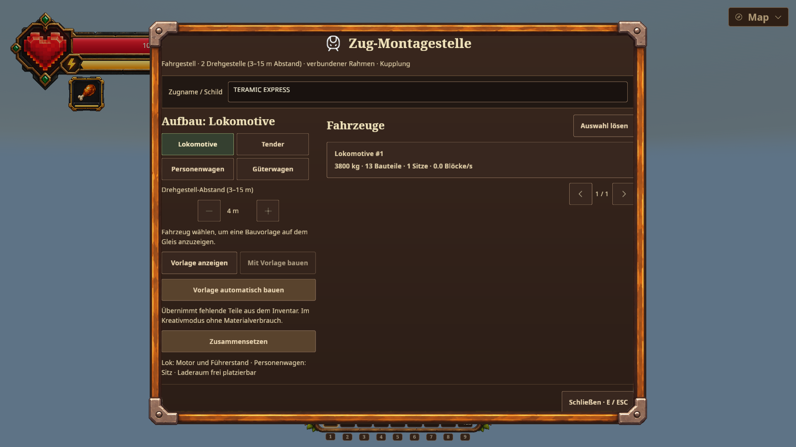
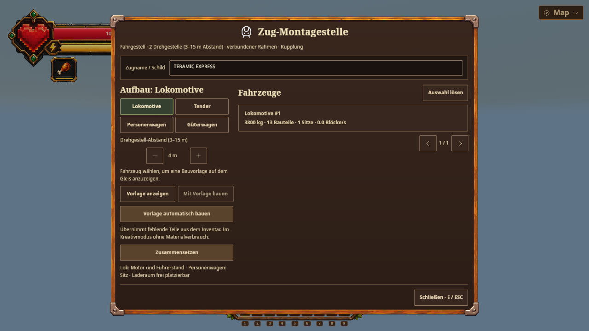

# Zugwerkstatt, Prellboecke, Kessel, Schilder und Licht

Die Werkstatt baut die angezeigte Vorlage mit einer eigenen Serveraktion.
Es werden ausschliesslich fehlende Teile gesetzt; passende Teile und deren
Holzvarianten bleiben erhalten. Der Ueberlebensmodus bezahlt echte
Inventarstapel, Creative benoetigt keine Materialien. Rechte, geladene Zellen,
Gleiskontakte, Figuren und Fahrzeuge werden vor der gemeinsamen Publikation
von Sections und Inventar geprueft. Die frische Inventarantwort erreicht den
Bauenden vor der Zugantwort. Die neue Aktion besitzt einen echten UDP-Test
mit einem bauenden und einem beobachtenden Client.

Prellboecke begrenzen die Bewegung vor ihrem Anschlag. Die Bremsvorschau und
der letzte Bewegungsschritt beruecksichtigen auch den Wagenkasten und die
Kupplung. Die gleiche Pruefung gilt fuer mitgezogene Wagen; der gesamte
Verbund bleibt bei einer Kollision unveraendert. Ein Zug kann vom Anschlag
wegfahren. Tests pruefen alle vier Ausrichtungen sowie Anfahren, Bremsen und
anschliessendes Rueckwaertsfahren eines befeuerten Zuges.

Das Namensfeld erlaubt bis zu 24 druckbare Zeichen. E schliesst das Feld beim
Tippen nicht, ESC bleibt zum Schliessen verfuegbar. Namen werden
besitzgeprueft gespeichert und an beide Clients repliziert. Die Schrift auf
Nummernschildern und der Rauchkammertuer besitzt eine eigene, versetzte Ebene.
Namensaenderungen ersetzen nur die kleine Schriftgeometrie. Zugindex ID16
uebernimmt ID13, ID14 und ID15; echte Speicher-/Ladepruefungen erhalten
Fahrzeug, Inventare, Brennstoff und den neuen Namen. Protokoll 121 ist fuer
Client und Server erforderlich.

Kessel erkennen einen drei Bloecke breiten Zugrahmen einschliesslich voller
Verkleidung auf dem Rahmen. Die gespeicherte Pose unterscheidet zwischen
kleinem und 3x3-Querschnitt. Modell, Normalen, Tangenten, Auswahl und Kollision
verwenden dieselbe Pose. Die Kollisionsabnahme umfasst die obere seitliche
Luecke und einen anschliessenden Section-Import.

Front-/Seitenscheinwerfer verwenden echte warme Spotlights mit 48 m Reichweite.
Die neue herstellbare Wagen-Deckenleuchte beleuchtet bis zu sieben Meter
nach unten. Bewegte Lampen erben den geglaetteten Wagentransform. Maximal
zwoelf nahe Lampen und 32 Beschriftungen begrenzen die Zusatzarbeit.
Ausrichtung, Lichtkegel und endliche, nicht koplanare Schrift werden geprueft.

Vier nahe Zuege teilen eine Stereo-Klangmischung fuer Antrieb, Feuer und
Schienenlauf. Geschwindigkeit, Motorausruestung, bestaetigter Antrieb,
Entfernung, Master-/Ambiente-Lautstaerke und Stummschaltung steuern den Klang.
Die neuen Lok-/Gleisklaenge werden deterministisch synthetisiert in
[build_train_audio.py](../../../../tools/assets/build_train_audio.py); der
Brennraum verwendet die vorhandene Ofenaufnahme. Tests dekodieren die Dateien
und pruefen hoerbaren, endlichen begrenzten Ausgang sowie stillstehende und
ausrollende Wagen. Eine menschliche Hoerabnahme bleibt unter A02 offen.

Beim Streaming bereitet ein einzelner Hintergrundjob pro Client kalte
Gleisbelegung und Kollisionsschnitte vor der unveraenderten Section-Validierung
vor. Ein Budget zwischen Kontrollimporten verteilt die Publikation ueber
Frames. Kleine Belegungsdaten bleiben unabhaengig von den 64 schweren
Geometrieprofilen erhalten. Weitere 256 kleine Kollisionsprofile verhindern,
dass Wasser-/Picking-Abfragen nach einer Verdrängung die schwere Geometrie
auf dem Hauptthread neu berechnen. Ein Regressionstest verdraengt mehr als
64 Geometrieprofile und prueft die weiterverwendeten Belegungs- und
Kollisionsdaten anhand ihrer erhaltenen Arc-Identitaet.

Die native UI-Pruefung verwendet eine isolierte Konfiguration und ein
synthetisches Fahrzeug. Sie dient der Kontrolle des tatsaechlich gerenderten
Layouts. Die Serveraktionen werden getrennt ueber echte UDP-Verbindungen
geprueft. Es wurde keine manuelle Fahrt in einer vorhandenen Problemwelt und
kein dortiger Vergleich der 0,4-s-Streaming-Aussetzer durchgefuehrt.

## Ergebnisse

`cargo test --locked --workspace --lib --bins --no-fail-fast -- --test-threads=4`
besteht mit **4.465 bestandenen Tests, null Fehlern und zehn bestehenden
ignorierten Tests** in zwoelf Testprogrammen. Nach einer abschliessenden privaten
Schriftgeometrie-Korrektur bestehen beide gezielten
`trains::accessories`-Tests erneut. Die folgenden Pruefungen bestehen ebenfalls:

- `cargo build --locked --workspace`, einschliesslich Client-/Server-Linking.
- `cargo clippy --locked --workspace --all-targets -- -D warnings`.
- `cargo fmt --all -- --check` und `git diff --check`.
- Nativer Vulkan-Lauf mit `TERRA_TRAIN_WORKSHOP_LIVE=1` und
  `TERRA_PREVIEW_WARMUP=1`, beendet mit Exitcode null, ohne Panic oder Fehlerlog.

Die native Pruefung wartet auf den abgeschlossenen Asset-Start und kontrolliert
die tatsaechlich gezeichneten Grenzen von Namensfeld, automatischem Baubutton und
Schliessen-Button. Der Rahmen reicht in 1920x1080 von (349,43) bis (1571,1037),
in 1280x720 von (235,29) bis (1045,691). Alle drei Bedienelemente halten Abstand
zum Rahmen. Ein anfangs abgeschnittener unterer Bedienbereich wurde behoben;
die gesamte Montageansicht wird nun einschliesslich ihres Inhalts eingepasst.

Die isolierte Konfiguration und das synthetische Testfahrzeug werden nicht
mitgeliefert. Die Aufnahmen zeigen die native Montageansicht, keinen Nachweis
einer Fahrt oder einer menschlichen Hoerabnahme.

Nachweise: [Workspace-Tests](tests.log), [Schrift-/Lichttests](accessories-tests.log),
[Build](build.log), [Clippy](clippy.log), [Nativer UI-Lauf](native-workshop.log),
[Pruefsummen und Status](verification.txt).
